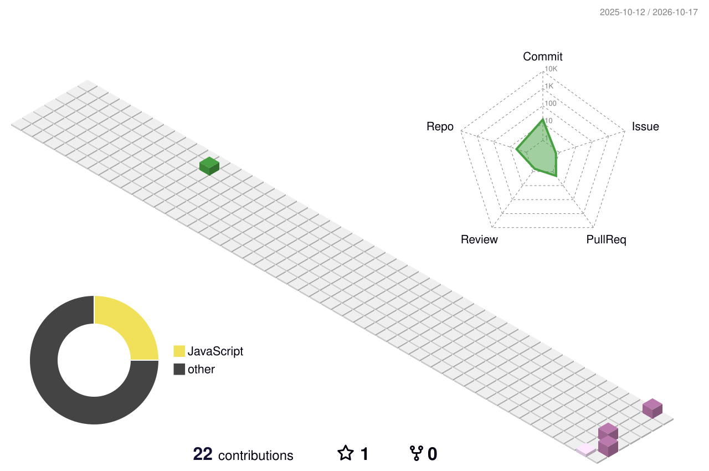

<h3 align="center">
  CSE Undergraduate | Software Development | AI/ML | DSA
</h3>

---

## 🚀 About Me

- 🎓 CSE undergraduate
- 💻 Interested in Software Development, AI/ML and DSA
- 🧠 Currently improving my problem-solving and development skills
- 🚀 Building projects and exploring new technologies
- 📚 Always learning something new

---

## 🛠️ Tech Stack

---

<!-- GitHub Statistics -->
<h2 align="center">📊 GitHub Analytics</h2>

  <i>A snapshot of my coding journey and open-source activity.</i>

  
  

 

<!-- Contribution Streak -->
<h2 align="center">🔥 Contribution Streak</h2>

  <i>Consistency is the key to growth.</i>

  

---

---
## 🌍 3D Contribution Calendar

  

## 🐍 Contribution Snake

  <i>My contributions, one commit at a time.</i>

<picture>
  <source
    media="(prefers-color-scheme: dark)"
    srcset="https://raw.githubusercontent.com/comet1135/comet1135/output/github-contribution-grid-snake-dark.svg"
  />

  <source
    media="(prefers-color-scheme: light)"
    srcset="https://raw.githubusercontent.com/comet1135/comet1135/output/github-contribution-grid-snake.svg"
  />

  
</picture>

---

## 📌 Featured Projects

| Project | Description |
|---|---|
| 🤖 CircuitSage AI | AI-powered electronics assistant |
| ⏱️ Stopwatch | Simple stopwatch application |
| 🎯 Guessing Game | Number guessing game |

---
